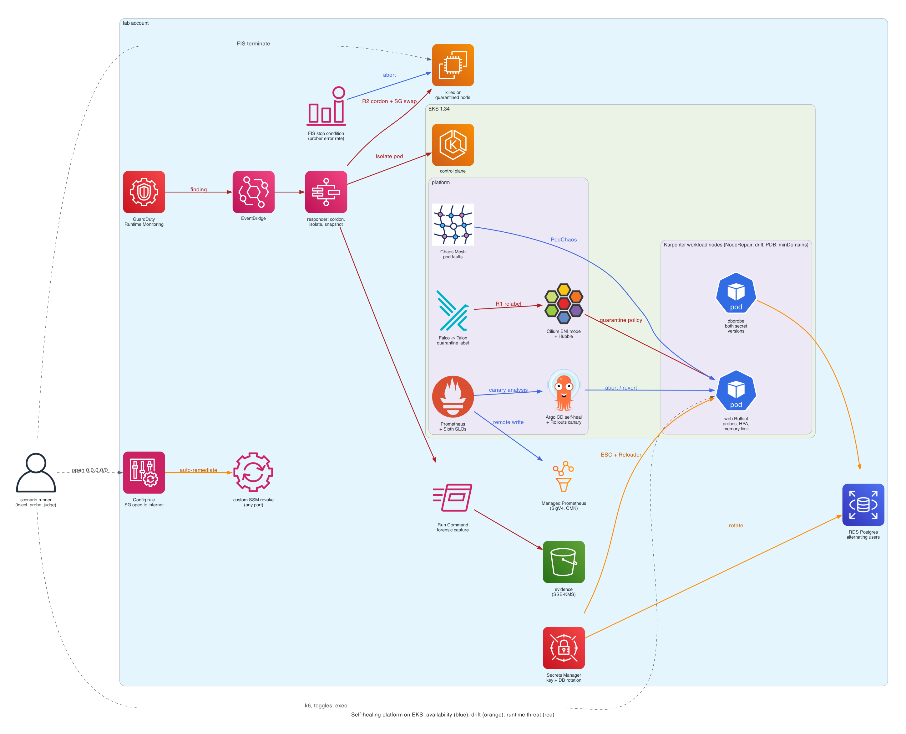
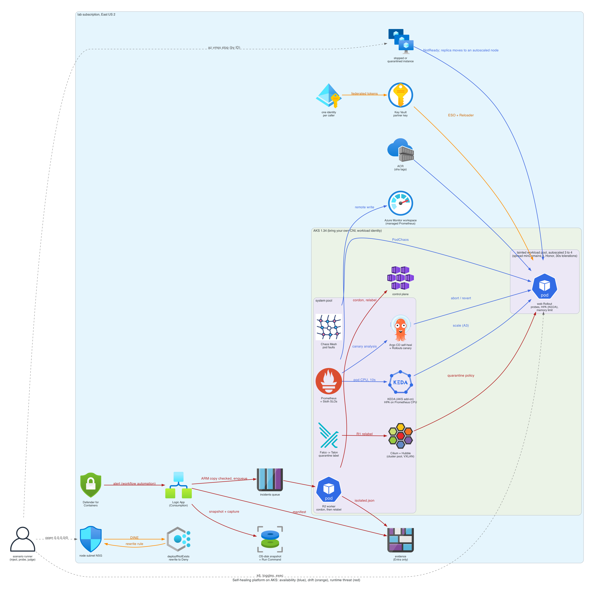
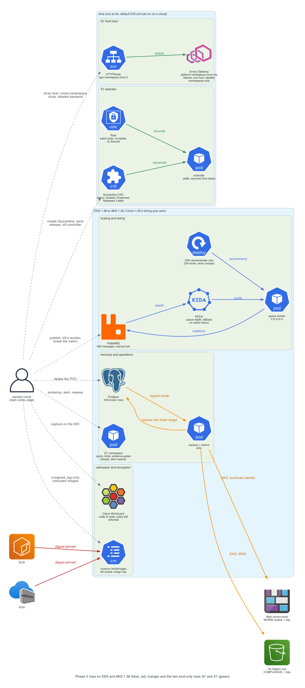
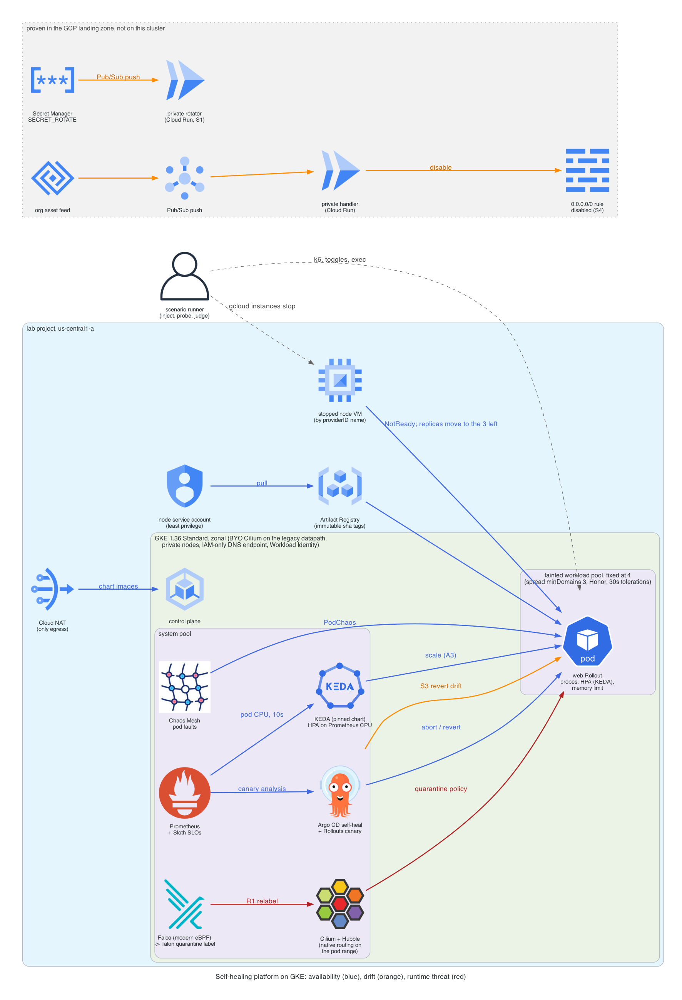

# Kubernetes Self-Healing Platform

A cluster that recovers on its own from outages, security drift and an active
threat, proven with before/after experiments. The third lab in the arc after
the EKS Attack Range (gain access, detect) and the Kubernetes Network
Segmentation Lab (contain): this one responds and recovers.

**Status:** five phases have run live and been destroyed. The portable core
runs on kind (zero cloud spend). The AWS module on EKS has every one of its 13
core rows healed on record (R1 missed once at 34.6s and healed at 16.1s and
11s on later runs, A4 became conclusive on a rerun). The Azure module on AKS
healed 10 of its 11 core rows (A3 healed at 281 ms on a rerun, R2 stays
blocked because Defender never raised the alert). Phase 4 added seven more
rows, run on both clouds on Kubernetes 1.36 (Q1 to Q3, P1, D1, O1, N1). Every
phase 4 row healed on AKS. On EKS six healed and N1 stayed inconclusive
because its baseline never showed impact. Two more rows, G1 (a Gateway API
front door) and X1 (a Quarantine custom resource and its controller), ran on
kind and then once on each cloud, and all four cloud runs healed. The GKE
module ran the eight in-cluster rows and healed five; A3, A5 and R1 missed by
19 ms, 0.17 points and 2s, each reported as a miss. Counting the three clouds
that is 50 hardened rows, 45 healed, three missed, one inconclusive, one
blocked. An integrated adversarial proof on one cluster
([ADR-0024](docs/adr/0024-integrated-adversarial-proof.md), designed, not
built) comes next.



*The EKS module. Blue edges are the availability loop (probes, canary
analysis, Karpenter, a CloudWatch stop condition on the node kill), orange is
drift (secret and database rotation, a Config rule with a custom SSM revoke),
red is runtime threat response (Falco to a Cilium quarantine, GuardDuty to a
Step Functions responder that cordons, isolates and captures evidence). The
dashed grey edges are the scenario runner injecting faults from outside.
Source: `docs/diagram.py`.*



*The AKS module, same colours. Availability adds a scale set instance stop
and KEDA scaling the HPA from Prometheus; drift adds Key Vault through
workload identity and an Azure Policy deployIfNotExists that rewrites an open
NSG rule to Deny; threat response runs Defender for Containers to a Logic App
that checks ARM's own copy of the alert before an in-cluster worker cordons
and relabels. Source: `docs/diagram_azure.py`.*

## The experiment

Every row states a steady-state hypothesis, injects one fault, and runs twice:
a **baseline** profile and a **hardened** profile. Only manifests and policy
differ between the runs ([ADR-0001](docs/adr/0001-change-only-manifests.md)).
User impact is measured by an independent prober, never by the app's own
metrics.

| Row | Fault | Injected with | Healing control |
|---|---|---|---|
| A1 | App deadlocks, then a second pod is killed | app toggle, Chaos Mesh PodChaos | readiness + liveness probes, replicas, preStop |
| A2 | Bad release (30% 5xx) | a Git commit of a new image tag | Argo Rollouts canary + Prometheus analysis on the canary's own pods, auto-abort |
| A3 | 4x traffic spike | k6 | HPA |
| A5 | Memory leak | app toggle | memory limit, kubelet restart, OOM alert with runbook |
| S1 | API key rotated in the secret backend | backend write + partner revocation after a grace window | ESO 10s refresh + Reloader restart |
| S2 | Certificate reaches its renewal window | see [ADR-0004](docs/adr/0004-in-cluster-git-and-forced-renewal.md) | cert-manager renewal + TLS hot reload |
| S3 | Network policy deleted, Deployment hand-edited | kubectl | Argo CD self-heal |
| R1 | Shell spawned in a web pod | kubectl exec | Falco -> Falcosidekick -> Talon relabel -> quarantine CiliumNetworkPolicy; evidence captured before the pod is deleted |

On EKS (phase 2) the same eight rows run unchanged, plus five that need a cloud:

| Row | Fault | Injected with | Healing control |
|---|---|---|---|
| A4 | The node hosting the most web pods dies | AWS FIS instance terminate, stopped by a CloudWatch alarm on the prober's error rate | Karpenter replacement, PDB, topology spread across zones |
| S1b | Database password rotated twice | Secrets Manager alternating-users rotation | both secret versions mounted and re-read per connection |
| S4 | Lab security group opened to 0.0.0.0/0 | an ingress rule | AWS Config rule + custom SSM Automation revoke (any port) |
| S5 | Every workload node replaced for a new AMI | EC2NodeClass AMI alias change | Karpenter drift, one node at a time, PDB |
| R2 | Runtime threat in a web pod | DNS lookup of GuardDuty's C2 test domain | GuardDuty Runtime Monitoring -> EventBridge -> Step Functions: quarantine pod and node, snapshot, Run Command capture, evidence to SSE-KMS S3 |

The AWS design is in [ADR-0006](docs/adr/0006-aws-module-design.md), the facts
it rests on in [ADR-0005](docs/adr/0005-aws-build-time-verification.md), and
the live session (apply from saved plans, a four-step teardown, verify-gone)
in [docs/runbook-aws.md](docs/runbook-aws.md).

The runner exits non-zero unless every hardened row is healed. A hardened row
counts as healed only if the same run's baseline showed impact; a row that
cannot be measured is an error, never a skip (`scenarios/judge.py`, unit
tested by `make test`).

On AKS (phase 3) eleven rows run: the eight core rows, A4, S4 and R2, each
rebuilt on Azure's own services ([ADR-0008](docs/adr/0008-azure-module-design.md),
facts in [ADR-0007](docs/adr/0007-azure-facts-before-the-module.md), session in
[docs/runbook-azure.md](docs/runbook-azure.md)):

| Row | Fault | Injected with | Healing control |
|---|---|---|---|
| A4 | The workload node hosting the most web pods stops | `az vmss stop` of one scale set instance by ID | cluster autoscaler, PDB, topology spread with `minDomains`, 30s not-ready tolerations |
| S4 | Node subnet NSG opened to 0.0.0.0/0 | an inbound Allow rule | Azure Policy deployIfNotExists rewrites the rule to Deny |
| R2 | Runtime threat in a web pod | Microsoft's threat-intelligence test request | Defender for Containers -> workflow automation -> Logic App (checks ARM's copy) -> queue -> worker: cordon, relabel, OS-disk snapshot, Run Command capture |

On both clouds (phase 4) seven more rows run, each judged against a baseline
in the same run ([ADR-0018](docs/adr/0018-phase4-remaining-rows-docs-pass.md)
for the cloud docs pass and ADR-0016, 0017, 0019 to 0023 for each parity
contract):



*The phase 4 rows. Blue is scaling and sizing, red is admission and
encryption, orange is recovery and operations, and the dashed grey edges are
the runner. The two object stores are the per-cloud pair. Green is G1 and X1,
which ran on kind, EKS and AKS, with the per-cloud internal load balancers shown
for G1. Source:
`docs/diagram_phase4.py`.*

| Row | Fault | Healing control | EKS | AKS |
|---|---|---|---|---|
| Q1 | 240 queued messages, a busy worker killed mid-message | KEDA scales from zero on queue depth, manual ack redelivers | healed, 240 of 240 done, 0 duplicates, drained 37s | healed, 240 of 240 done, 0 duplicates, drained 35s |
| Q2 | The scaling metric breaks during load | KEDA fallback replica count, capacity ceiling | healed, fallback at 30s, 0.17% failures | healed, fallback at 16s, 0.14% failures |
| Q3 | Sustained CPU and memory pressure | VPA recommender in Off mode, nothing resized | healed, recommendation at 4s, 0 restarts | healed, recommendation at 2s, 0 restarts |
| P1 | Unsigned, invalid, untrusted, tag-only images and a verifier outage | Kyverno verifies a cosign signature on a pinned digest, fails closed | healed, verifier back in 16.6s | healed, verifier back in 16.2s |
| D1 | The database volume is replaced | logical backup into an object-locked store, restore into a fresh target | healed, 100 exact rows restored in 43s, S3 Object Lock | healed, 100 exact rows restored in 48s, locked Blob WORM |
| O1 | A broad operator and a dead controller | namespace quota, least-privilege roles, evidence-gated quarantine release | healed after one timeout rerun, release at 5s | healed, release at 2s |
| N1 | Cross-node pod traffic on the wire | Cilium WireGuard | **inconclusive** in four runs, baseline showed no impact | healed, 40,892 WireGuard packets, 0 VXLAN, marker no longer visible |

N1 on EKS never produced an impact in its baseline, so the runner refused to
claim a heal. The cause was found on AKS afterwards. A shared allow-all
`CiliumNetworkPolicy` over the namespace overrode the narrower deny, because
Cilium policies are additive ([ADR-0023](docs/adr/0023-n1-cloud-parity-contract.md)).
The fix landed before the AKS pass and EKS has not been rerun, so the EKS row
stays inconclusive in the record.

### Two more rows, on kind, EKS and AKS

The Kubernetes Explained checklist this lab was compared against listed a
north-south entrance and authored operators as the two ideas the platform did
not yet prove. G1 and X1 close those gaps. Both ran on kind first, then once on
each cloud in a paid session.

| Row | Fault | Healing control | Result |
|---|---|---|---|
| G1 | An app team attaches a route for a stray hostname, a route from another namespace, and a route to a deleted backend | Envoy Gateway, platform namespace owns one listener bound to one hostname and to labelled namespaces, the app team owns its HTTPRoute, internal load balancer on the clouds, hardened-only TLS from the lab CA ([ADR-0025](docs/adr/0025-g1-gateway-api-front-door.md)) | healed on kind twice (`kind-g1-run1`, `run2`), on EKS (`eks-g1-run1`) and on AKS (`aks-g1-run2`). The stray host and the cross-namespace route got 404 instead of being served, the legitimate route stayed up, TLS was ready in 0.9 to 1.2s on the clouds |
| X1 | A responder isolates a compromised pod and then releases it before evidence exists | A `Quarantine` custom resource and a controller that isolates, waits for evidence bound to the pod UID, and releases only on a later request ([ADR-0026](docs/adr/0026-x1-quarantine-operator.md)) | healed on kind (`kind-x1-run6`, `run7`), on EKS (`eks-x1-run1`, isolated in 4.6s, unreachable at 9.2s, resumed in 7.0s) and on AKS (`aks-x1-run1`, 2.6s, 13.7s, 5.6s). Early release was refused in each |

Honest limits on G1.

- The deleted-backend 500 and the unrouted 404 were the same in the baseline and
  the hardened run, because Gateway API isolates a broken route by itself, so
  only the role split is the hardening.
- The proxy pod kill lost 0 of 22 and 0 of 19 requests on kind, 0 of 4 on EKS and
  0 of 6 on AKS. It stays informational, no bound is judged.
- The load balancer address clock does not compare across clouds. It read 77s on
  AKS and 4.0s on EKS, because the AWS provider reports the load balancer as
  ensured while the NLB is still provisioning. Time to first served request on a
  cold NLB was not measured, and the EKS first request (11.5s) hit an NLB that
  had been active since bootstrap.
- Each cloud ran once. The AKS first run is kept as a recorded miss (below).

One honest limit on X1. "Pod unreachable" times include up to 3s of probe
timeout, and on Cilium they include a deliberate identity delay (below), so the
isolated time is the number that measures the controller.

Cilium Gateway API was the first choice for G1 and was ruled out by reading its
documentation. It needs `kubeProxyReplacement=true`, which none of the three
targets run, and turning it on would have changed the data plane under every
proven row.

## Run it

```
make up      # kind + Cilium + platform charts + bootstrap
make demo    # baseline then hardened, every row -> evidence/<run-id>/report.md
make down
```

G1 and X1 have their own kind clusters. `make g1-up` then
`make demo ROWS=G1`, or `make x1-up` then `make demo ROWS=X1`. On the clouds they
run with `TARGET=eks` or `TARGET=aks` inside a paid session. GKE runs the
in-cluster rows with `TARGET=gke`.

Needs docker (about 4 GB free for the cluster), kind, kubectl, helm, cilium,
hubble, jq, openssl 3.4+ and python3. The lab uses its own kubeconfig
(`.kube/config`), so it never touches other clusters on the machine.
The cloud modules run from saved plans in one bounded session each:
[docs/runbook-aws.md](docs/runbook-aws.md),
[docs/runbook-azure.md](docs/runbook-azure.md) and
[docs/runbook-gcp.md](docs/runbook-gcp.md).

## Stack (pinned in the Makefile)

Cilium 1.20.4, Argo CD v3.5.7, Argo Rollouts v1.10.1, External Secrets
v2.14.0, Reloader v1.4.23, cert-manager v1.21.3, Falco 0.45.2 + Falcosidekick
2.35.1 + Falco Talon 0.3.0, kube-prometheus-stack 92.17.1, Sloth v0.13.0,
Chaos Mesh 2.8.7, k6 v2.3.0; on AKS, the managed KEDA add-on; on GKE, KEDA 2.21.0 from the chart. CI: platform-guardrails v1.10.0.

## Phase 1 result (kind)

Two reference runs on the same commit (`evidence/kind-run5`, `evidence/kind-run7`):
every baseline row showed impact, and hardened A1, A2, A5, S1, S2, S3 and R1
healed in both. Hardened A3 met its error bar (0.3%) and scaled 3 to 8 and 3 to
10 pods, but missed its 300 ms p95 bar (758 ms, 697 ms). The runner reports
that as a FAIL and is meant to: the 300 ms bar is not lowered for kind, and
A3 latency is proven on EKS instead.

## Phase 2 result (EKS)

One bounded live session on 2026-11-04 (EKS 1.34, two t3.large system nodes,
Karpenter c6a.large workload nodes, about $6 for roughly ten hours up). Reference evidence:
`evidence/eks-run2` (every row), `evidence/eks-run2-rows` and
`evidence/eks-run2-a4r1` (the rows rerun after fixes). Every fix made after a
run was observed is listed in [ADR-0003](docs/adr/0003-per-target-thresholds.md)
with the run that prompted it; no threshold was changed.

| Row | Hardened result on EKS | Run |
|---|---|---|
| A1 | healed: 0.00% errors after detection, hung pod serving again at 35s | eks-run2 |
| A2 | healed: canary aborted at 67s on measured errors, only v1 after, 0.00% | eks-run2 |
| A3 | healed: sustained-spike p95 **267 ms** (bar 300), 0.00% errors, HPA 3 to 8 | eks-run2 |
| A4 | **inconclusive**: hardened met every criterion twice (0.00% and 0.13% errors, every replica serving at 78s), but neither same-run baseline showed impact (one errored on a stale FIS tag, one had its pods spread already) | eks-run2-rows, eks-run2-a4r1 |
| A5 | healed: OOMKilled at 10s, serving and paged at 14s | eks-run2 |
| S1 | healed: 0 failed of 1856 across a key rotation | eks-run2 |
| S1b | healed: 0 failed queries, 0 dropped connections across two alternating-user rotations; the original password was rejected | eks-run2-rows |
| S2 | healed: 0 TLS errors, renewed certificate served at 86s | eks-run2 |
| S3 | healed: policy restored at 2s, hand edit reverted at 4s | eks-run2 |
| S4 | healed: Config flagged the open group at 108s, the SSM document revoked it at 132s (bar 600) | eks-run2 |
| S5 | healed: all 3 workload nodes replaced for a new AMI in 256s, 0 failed, never more than 1 disrupted | eks-run2 |
| R1 | **miss**: isolated at 34.6s against 30s (`eks-run2-rows`); 16.1s in `eks-run2-a4r1` | eks-run2-rows |
| R2 | healed: GuardDuty finding at 144s, pod and node isolated at 155s, evidence (snapshot, Run Command capture, manifest) at 172s, 0.00% errors | eks-run2-rows |

A3 is the row kind could not prove: on worker nodes that do not host the
control plane, the same 300 ms bar holds. A4's hardened behaviour is measured
and recorded, but the runner only claims a heal against a baseline impact in
the same run, and the baseline has no spread rule, so whether its replicas
share a node depends on how many workload nodes already exist; `eks-run2`'s
baseline is the one that shows the failure (all three replicas on the killed
node, 56% errors). R1 met 30s once and missed once on EKS: Talon labels the pod
within 2s, and the rest is Cilium applying the quarantine identity plus the
runner proving unreachability through `kubectl exec` over the internet.

## Phase 3 result (AKS)

One bounded live session on 2026-11-05 (AKS 1.34, three Standard_D2s_v3
system nodes, a tainted Standard_D2s_v6 workload pool autoscaled 3 to 4,
Cilium on bring-your-own CNI, about $8 for roughly nine and a half hours up).
Reference evidence: `evidence/aks-run1` (every row), `evidence/aks-run1-rows`
(S3, S4, R1, R2 after a runner fix), `evidence/aks-run1-s4` and
`evidence/aks-run1-a3` (after the fixes below). No threshold was changed.

| Row | Hardened result on AKS | Run |
|---|---|---|
| A1 | healed: 0.00% errors after detection, hung pod serving again at 31s | aks-run1 |
| A2 | healed: canary aborted at 80s, only v1 after, 0.00% | aks-run1 |
| A3 | **miss**: sustained-spike p95 **320 ms** (bar 300), 0.00% errors, HPA 3 to 7 through KEDA | aks-run1-a3 |
| A4 | healed: node NotReady at 59s, 0.00% errors from then, every replica serving at 172s on a new node; the same run's baseline hit 100% errors | aks-run1 |
| A5 | healed: OOMKilled at 9s, serving at 12s, paged at 21s | aks-run1 |
| S1 | healed: 0 failed of 450, pods on the new key at 33s | aks-run1 |
| S2 | healed: 0 TLS errors of 193, renewed certificate served at 79s | aks-run1 |
| S3 | healed: policy restored at 2s, hand edit reverted at 10s | aks-run1-rows |
| S4 | healed: the policy's own deployment rewrote the rule to Deny at 121s (bar 1200) | aks-run1-s4 |
| R1 | healed: detected at 1s, isolated at 8s, evidence at 24s, 0.00% errors | aks-run1-rows |
| R2 | **blocked**: no Defender alert naming the pod in 3600s, three times, so the response never had anything to act on | aks-run1-rows |

A4 is conclusive on AKS where it was not on EKS: the baseline packs every
replica onto one node by design, so the same run shows both the failure and
the heal. A3 got from 821 ms to 320 ms once the HPA stopped waiting on
metrics-server (below); the rest is the shared CPU target, and lowering it on
AKS alone would be tuning a control on the target that missed. R2's
responder is built and its parts passed their live checks, but the row is
unproven on Azure until Defender fires.

### Reruns after phases 2 and 3

- EKS A4 and R1 (`evidence/eks-run3`): A4 healed with the baseline impact in
  the same run, so it is conclusive, and R1 isolated in 11s. The 34.6s miss
  stays in `evidence/eks-run2-rows`.
- AKS A3 (`evidence/aks-run2-a3`): healed at p95 281.1 ms, 0.00% errors, HPA
  3 to 8, against a same-run baseline of 2142 ms. The 320 ms miss in
  `evidence/aks-run1-a3` stays beside it, with the 300 ms bar unchanged.
- AKS R2 was not rerun. Defender raised no alert naming the pod in 3600s on
  either profile, so it is recorded as a platform limitation.

## Phase 5 result (GKE)

One bounded live session on 2026-11-18 (GKE 1.36.5 Standard, zonal, three
e2-standard-2 system nodes and a tainted workload pool fixed at four, Cilium
on bring-your-own CNI over the legacy datapath, private nodes behind an
IAM-only DNS endpoint, about $1 for two hours up). GKE runs the in-cluster
rows only ([ADR-0027](docs/adr/0027-gke-facts-before-the-module.md)): the
GCP-native responses (secret rotation, an open firewall rule reverted from an
org asset feed, a Pub/Sub-driven incident handler) were proven in the
[GCP landing zone](https://github.com/jordann6/gcp-landing-zone) on a
different cluster and are not claimed here. Reference evidence:
`evidence/gke-run1`. No threshold was changed.



*The GKE module, same colours. Availability adds a node VM stopped by the
name on its providerID and KEDA scaling the HPA from Prometheus; the
quarantine CiliumNetworkPolicy is the same file on all four targets. The grey
box is the landing zone's proof, drawn apart because it ran elsewhere.
Source: `docs/diagram_gcp.py`.*

| Row | Hardened result on GKE | Run |
|---|---|---|
| A1 | healed: 0.00% errors after detection, hung pod serving again at 36s | gke-run1 |
| A2 | healed: canary aborted at 70s, only v1 after, 0.00% | gke-run1 |
| A3 | **miss**: sustained-spike p95 **319.0 ms** (bar 300), 0.00% errors, HPA 3 to 10 through KEDA | gke-run1 |
| A4 | healed: node NotReady at 56s, 0.07% errors from then, every replica serving at 98s on the three nodes left; the same run's baseline hit 100% errors | gke-run1 |
| A5 | **miss**: 1.17% errors (bar 1%); OOMKilled at 14s, serving at 17s, paged at 21s | gke-run1 |
| S2 | healed: 0 TLS errors of 153, renewed certificate served at 60s | gke-run1 |
| S3 | healed: policy restored at 2s, hand edit reverted at 4s | gke-run1 |
| R1 | **miss**: detected at 2s, isolated at **32s** (bar 30s, 25 Hubble drops), evidence at 53s, 0.00% errors | gke-run1 |

The three misses are close and each has a known cause. A3 is the AKS result
again (320 ms before its rerun): the HPA no longer waits on metrics-server,
and the shared CPU target leaves the sustain window just over the bar, this
time at the 10-replica ceiling. A5's kill, restart and page all passed their
clocks; the six failed requests of 514 came 9 to 11s after injection, before
the kill, while the container stalled under memory pressure. R1's 2s is
Cilium's identity grace period plus jitter (the ADR-0002 addendum), the same
cause as EKS's 34.6s. A4 shows the gap a stopped VM leaves: 35.6% of requests
failed in the 56s before the node was marked NotReady (reported, not judged,
as on AKS), and GKE's managed instance group started the VM again by itself
at 134s, after the replicas had moved.

## What broke (and what it taught)

### On GCP (phase 5)

- **The autoscaler and strict spread don't mix.** Google's docs say the GKE
  cluster autoscaler does not support topology spread with
  `whenUnsatisfiable: DoNotSchedule`, which is the hardened A4 placement on
  every cloud. The workload pool is four fixed nodes instead, so one stopped
  node leaves three domains for `minDomains: 3` and no autoscaler decision
  sits in the measured path.
- **Dataplane V2 could not carry the quarantine policy.** GKE's managed
  Cilium documents cluster-wide policies with selectors, ports and CIDRs, and
  says nothing about the `ingressDeny`, `egressDeny` and `host` entity R1
  relies on. Pinned Cilium on the legacy datapath kept the file unchanged; the
  cost is a CNI Google does not support, as on AKS.
- **A new project has three CPU limits, and disks count as SSD.** Regional
  `CPUS` was 200, but `CPUS_ALL_REGIONS` was 32, `E2_CPUS` 24, and
  pd-balanced boot disks draw on `SSD_TOTAL_GB` (500, the lab needs 400 with a
  surge node). The preflight now reads all three.
- **An unreadable answer looked like "nothing there".** Aggregated
  `gcloud compute ... list` calls exit 0 when the project cannot be read and
  say so only on stderr, so the teardown proof printed "gone" for a query
  that failed. Any stderr error is now a failed query. The same mistake, a
  discarded `kubectl logs` error, made the Falco check count 4 of 7 probes
  while all 7 were loaded.
- **A stopped VM comes back on its own.** The docs say a managed instance
  group "might" recreate or revert a VM changed outside it. It started the
  stopped node at 134s. A4 already counted only the three nodes that stayed
  up, so the restart could not heal the row, but a fault injector that
  assumes a stopped VM stays stopped would.

### On kind (G1 and X1)

- **Argo CD hid the Gateway kinds and still reported healthy.** Its
  `resource.inclusions` list watches only the kinds the lab deploys, so the
  Gateway, GatewayClass, HTTPRoute and EnvoyProxy objects were excluded, the app
  showed Synced and Healthy, and nothing had been applied. It is the same class
  of failure as the Q1 ScaledObject that stalled on EKS. The kinds are now in the
  base and EKS lists, and a test keeps the two lists in step.
- **The controller ignored SIGTERM, so the "kill" was not a kill.** As PID 1 a
  Python process ignores SIGTERM unless it installs a handler, so a deleted
  controller kept reconciling for its 30s grace period and handled the next
  Quarantine. The row's resume time was real but measured the old pod. The
  controller now exits on SIGTERM and the runner force-kills it.
- **A baseline probe that was too early read as "no impact".** The manual
  release was checked 3s after the label came off, before the network policy
  engine had applied it, so a premature release looked harmless and the runner
  correctly refused to call the hardened run healed. It now polls for up to 40s.
- **Cilium enforced the label change 12 to 33s late, and it was Cilium's own
  timer.** The controller marked the pod isolated in under 2s, but the pod stayed
  reachable for 11.9, 28.0, 17.5 and 33.2s across four Cilium runs, past a bound
  I first guessed at 15s and then raised to 30s after seeing the data (disclosed
  in the ADR). The agent log showed no allocation failures. Reading the v1.20.4
  source found the cause, `identity-change-grace-period` (5s) plus a random
  `identity-max-jitter` of up to 30s before an endpoint takes its new identity.
  Setting both to 1s made the pod block in about 2s, so it was not load, not
  allocation and not the datapath. The same jitter explains the 8 to 43s spread
  in R1's isolation evidence. The defaults stay, and X1 reports the delay
  instead of hiding it. X1 on Cilium passed on both clouds (EKS baseline
  unreachable at 32.5s shows the jitter).
- **The EKS and AKS runs found problems kind could not.**
  - The first AKS G1 run missed. The load balancer clock read the Gateway's
    `Programmed` transition time, which resets on every profile switch (608s and
    759s), when the real provisioning was 77s. The clock now runs from Service
    creation to the first `EnsuredLoadBalancer` event, the 300s bound is
    unchanged, and the missed run is kept beside the passing rerun.
  - Teardown re-created the load balancer. The predestroy script deleted two
    Argo CD apps, but the child apps self-heal and the application controller was
    still running, so Argo CD rebuilt the Gateway 2s after it was deleted and
    made a second NLB. Both predestroy scripts now scale the controller to 0 and
    wait for its pod to go first. That fix has not run against a cluster yet.
  - The in-tree AWS NLB creates no security group of its own. It adds rules to
    the node security group, including a NodePort rule open to `0.0.0.0/0`, so
    the leftover check cannot positively confirm a load balancer group.
    Restricting `loadBalancerSourceRanges` to the VPC CIDR is a later tightening.
  - Azure RBAC answers an impersonated permission check with "no - Azure does not
    have opinion", which crashed the X1 check until it read only the first word.
- **Argo CD never prunes a CRD.** Switching back to the baseline removed the
  controller and its Role but left the CRD, so the baseline claims that no
  controller is acting, not that the CRD is absent.

### On both clouds (phase 4)

- **A shared allow-all policy silently overrode one row's deny.** Cilium
  policies are additive, so a namespace-wide allow beat the narrower rule and
  the N1 baseline showed no impact in four EKS runs. The N1 pods are now
  excluded from the allow-all, and the AKS run passed.
- **Watchers perturbed the measurement.** Diagnostic pods that exec'd into the
  client every few seconds delayed the N1 probe past its 8s capture window.
  Nothing touches the cluster during a row now, and diagnosis happens after.
- **Wrong assumptions in code that had only run on kind.** D1 failed twice on
  Azure (a version id read from the wrong place, and an administrator delete
  the CLI cannot express as a version delete) and once on AWS (an
  organization policy requiring server-side encryption on the upload). Each
  failed run is kept beside the passing one.
- **Teardown has its own failure modes.** A scale set rolling upgrade started
  by the platform blocked deletion of the system pool until it was cancelled,
  and a store with COMPLIANCE retention cannot be destroyed for 24 hours, so
  it lives in its own Terraform root.


### On Azure (phase 3)

- **The policy fired and its template failed.** Azure Policy started the S4
  remediation 100 seconds after the rule opened, and ARM rejected the
  deployment: a parameter typed array received a string. The rule has one
  port, so its port list is empty, and Policy's `field()` hands an empty
  property over as a string, not null, so `coalesce()` never applied. A
  deployment that fails validation never appears in the resource group, so
  the row only saw "no deployment"; the Activity Log's
  `deployIfNotExists/action` entry held the reason. Every value now crosses as
  a string and the template decides the defaults, checked with `what-if` for
  every shape before the rerun healed at 121s.
- **The managed metrics-server is a 60s ceiling.** AKS runs its own
  metrics-server without `--metric-resolution`, so the upstream 60s default
  (kind and EKS run 15s), and it cannot be replaced. The HPA scaled at 69s
  against EKS's 32s and the sustain window opened on a backlog: p95 821 ms.
  KEDA, the managed add-on, now drives the same HPA from Prometheus's 10s
  cAdvisor scrape: scaled at 42s, p95 320 ms.
- **Defender's runtime detection never fired.** Microsoft's own
  threat-intelligence test request (the one in their attack simulation) ran
  three times from a web pod: no alert in an hour each time, while a
  control-plane alert did arrive. The managed sensor was chart 0.8.61 with its
  antimalware collector off although the plan and the cluster profile both
  said enabled, and Microsoft's antimalware detection needs 0.10.x. R2 is
  recorded as blocked, not as a heal or a miss.
- **The autoscaler's cleanup looked like a quarantine.** After A4 the runner
  started the stopped instance again, the autoscaler had already added a
  replacement and removed the now-empty node, and the steady-state check read
  its cordon as an R2 leftover and asked AKS to delete a machine that was
  gone. Four rows errored in 20 seconds. Nodes carrying
  `ToBeDeletedByClusterAutoscaler` are now left to the autoscaler.
- **A wildcard that stops at a dot.** The R2 worker's egress policy allowed
  `*.cluster.local`, but Cilium's `*` matches one label, and with `ndots:5`
  every lookup first walks the search domains, so DNS for the queue failed
  with `EAI_AGAIN`. `**.` matches across labels.
- **Quota is a design input.** Legacy DSv3 increases are frozen, D2s_v5 was
  not offered to the subscription and a Dsv6 increase to 16 was refused; the
  regional total alone was raised. System and workload pools now use
  different families so each fits its own quota.
- **The same rule name brings back old records.** The runner reported S4
  non-compliant at 3s by matching the previous run's compliance record for
  the same rule. It now counts only records written after T0.

### On AWS (phase 2)

- **Module v21 installs no CNI.** terraform-aws-modules/eks v21 creates
  clusters with `bootstrap_self_managed_addons = false`, so the VPC CNI,
  kube-proxy and CoreDNS never appeared, the nodes stayed NotReady and the node
  group failed after 30 minutes. They are now explicit add-ons (CoreDNS
  tolerates the Cilium startup taint, and pods it started are restarted under
  Cilium).
- **A replacement pod landed on the node being quarantined.** The R2 responder
  relabelled the pod out of the Service, the Rollout created a replacement at
  once, and the scheduler bound it to the same node 0.2s before the cordon.
  The security group swap then cut it off while it still reported Ready
  (security groups are stateful, so the kubelet's API connection survived),
  and a third of requests failed for 100s. Cordon first, then relabel.
- **Topology spread without `minDomains` spreads nothing.** With one workload
  node, `DoNotSchedule` on hostname saw one domain and a skew of 0, so all
  three replicas sat on it and a node kill took every one. `minDomains` makes
  the missing nodes count, so the extra replicas go Pending and Karpenter
  launches a node for each.
- **AMP on a customer-managed key needs the caller's KMS permission.** Remote
  write returned 403 on `kms:GenerateDataKey`; after the fix AMP kept serving
  a cached denial for about four minutes.
- **Secrets Manager leaves `AWSPENDING` on the new current version.** Waiting
  for the label to disappear waited out every rotation.
- **ListFindings lags EventBridge.** The responder had acted on the GuardDuty
  event before the finding was listable, so the runner now waits for the
  finding itself and times detection from its `CreatedAt`.
- **A baseline can be broken before the fault.** Earlier runs had rotated the
  database password, so the baseline probe was failing for 30 minutes before
  S1b began. The runner now requires a clean window before T0, and the judge
  rejects an impact that was already there.
- **The laptop is part of the experiment.** It slept during a rerun and froze
  the runner while the cluster carried on; port-forwards through the EKS API
  also die over a two-hour run. `make demo` now holds an idle-sleep assertion
  and the Hubble query reconnects and fails loudly. Two runners on one cluster
  (run by hand, by mistake) contaminated each other; those runs are not
  evidence.
- **A PDB can strand nodes at teardown.** With the NodePool deleted, the web
  PDB allowed 0 disruptions, Karpenter's drain blocked, and the teardown
  removed Karpenter with two nodes still running. Predestroy now deletes the
  app first and stops if any node survives.
- **The organization keeps Config.** The landing zone's SCP denies deleting
  Config recorders, delivery channels and rules in member accounts, so the
  lab's recorder, rule, delivery bucket and its key stay after teardown (about
  $1 a month) and `eks-verify-gone` reports them as kept.

### On kind (phase 1)

- **Reloader silently never restarted the Rollout.** Its chart grants RBAC on
  `rollouts.argoproj.io` only if that API exists at install time. Installed
  before Argo Rollouts, it logged `forbidden` forever and the rotated key never
  reached the pods. Install order is now fixed and commented.
- **An empty metric result aborted healthy canaries.** The analysis judged new
  canary pods before Prometheus had two samples for them. It now waits 45s, and
  the judge only accepts an abort driven by a measured error rate.
- **A strict readiness probe starved the autoscaler.** Busy pods failed
  readiness, left the Service, pushed their load onto the rest, and the HPA
  ignored their CPU. Then a 1s liveness probe killed busy, healthy pods and
  turned a spike into a restart storm. Fix: forgiving probes plus load
  shedding (`MAX_INFLIGHT`), so overload gets fast 503s instead of a queue.
- **`ignoreDifferences` outlived the HPA.** With the replica count ignored for
  the HPA's sake, switching to a profile without an HPA froze the Rollout at
  the HPA's last count. Only the profile that has an HPA ignores replicas now.
- **Cilium identity allocation dominated time-to-isolate.** Talon labelled the
  pod within 2s, but a brand-new identity took 16-38s to allocate through a
  loaded API server. The quarantine identity is now pre-allocated (ADR-0002).
- **A single laptop node is the ceiling.** The full stack starved its own API
  server until the platform was trimmed (ESO CRDs and webhook, Argo CD watch
  scope, Hubble ring, no cAdvisor scrape), and the A3 latency bar is not
  reachable when every pod shares eight vCPUs with the control plane: even at
  rest p95 is 130-230 ms. A3 keeps its 300 ms bar everywhere: on kind it is
  recorded as errors healed, latency not reachable on one shared node, and
  the latency claim is proven on EKS ([ADR-0003](docs/adr/0003-per-target-thresholds.md)).

## At production scale

- **Prevent first, repair second.** S4 proves the detective layer; production
  puts a Deny policy (or an SCP and a permissions boundary on AWS) in front
  of it, so the repair only catches what prevention misses.
- **Pin the runtime sensor.** Install the Defender sensor (or GuardDuty's
  agent) at a pinned version, and alert on the sensor's own heartbeat and on
  a scheduled test detection, so a silent detector is an incident, not a
  surprise during one.
- **Size the autoscaler from a load test, not a default.** A3 showed the
  signal's freshness and the target utilization both decide tail latency;
  production sets the target per service from its latency objective and
  keeps a scale-up path that does not wait on a 60s metric.
- **Spread across zones and keep budgets explicit.** Topology spread with
  `minDomains`, PDBs and node disruption budgets per pool, with the
  replacement capacity sized so one zone loss stays under the error budget.
- **Put the Gateway behind an internal or a provider-managed load balancer and
  own the listener in the platform namespace.** G1 runs on a ClusterIP and calls
  the entrance from a pod. Production decides public versus internal per
  Gateway, terminates TLS from a managed certificate, and gives each app team
  route permissions in its own namespace and nothing on the Gateway.
- **An operator needs more than a poll loop.** X1's controller polls every
  second and keeps no cache. Production uses a watch, leader election so two
  replicas never both act, a finalizer decision that is made on purpose, and a
  framework or a long-term maintained library instead of a hand-written loop.
- **Encrypt etcd with your own key and admit only attested images.** The GKE
  lab leaves application-layer secrets encryption with Cloud KMS and Binary
  Authorization off, because a key ring can never be deleted and the lab pulls
  upstream images nobody here signs. Production turns both on, as the GCP
  landing zone's paved road does.
- **Evidence goes to an account the cluster cannot touch.** The labs write
  to a bucket or container in the lab; production writes to a separate
  security account or subscription with object lock or immutability.
